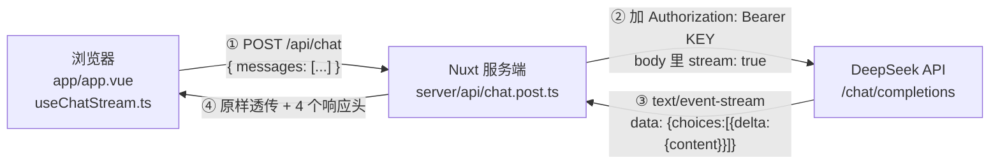

# 学习笔记 01 · 基础篇：一次请求是怎么跑起来的

> 这份笔记是「AI Agent Lab」项目的配套拆解，对应 2026-10 的第一阶段学习。
> 目标：**不看代码，能在 3 分钟内讲清一个请求的完整链路，并回答 5 个高频面试题。**

---

## 1. 架构与数据流

### 1.1 全景图



### 1.2 四个关键点

| 环节 | 做了什么 | 为什么 |
|---|---|---|
| ① 浏览器 → 服务端 | 只发 `messages`，**不带 Key** | 浏览器是公开环境 |
| ② 服务端 → DeepSeek | 注入 `Authorization`，设 `stream: true` | Key 只在服务端出现 |
| ③ DeepSeek → 服务端 | 返回 `text/event-stream` | 边生成边发 |
| ④ 服务端 → 浏览器 | **原样透传**，加 4 个响应头 | 不缓冲、不压缩、不延迟 |

### 1.3 被透传的 4 个响应头

```ts
setResponseHeaders(event, {
  'Content-Type': 'text/event-stream; charset=utf-8', // 这是 SSE
  'Cache-Control': 'no-cache, no-transform',          // 禁止缓存和压缩转换
  Connection: 'keep-alive',                               // 保持连接
  'X-Accel-Buffering': 'no'                              // 关掉 Nginx 的缓冲
})
```

> 少了 `no-transform` / `X-Accel-Buffering`，线上会出现「转半天，然后一次性刷出来」。

### 1.4 浏览器这一侧的解析循环

```
字节流
  → reader.read() 拿一块（chunk，大小不定）
  → TextDecoder 解码成字符串
  → 拼进 buffer
  → 按 \n 切行，最后一段留在 buffer（可能是半行）
  → 逐行判断 "data: " 前缀
  → JSON.parse
  → 取 json.choices[0].delta.content
  → 拼到当前消息上（Vue 响应式 → 页面逐字更新）
```

---

## 2. 为什么调用大模型必须经过服务器

### 2.1 根本原因：Key 必然泄露

**前端产物是打包成文件、下载到用户设备上的。用户拥有源码和所有请求。**

```
① 打开网站
② F12 → Sources 搜 "sk-"，或 Network 看 Authorization 头
③ 复制 Key
④ 循环调用 → 你的余额清零
```

不是「可能被看到」，而是**必然被看到**，只是时间问题。

### 2.2 加密没有用

| 手段 | 攻击成本 |
|---|---|
| Base64 | 1 秒 |
| 字符串拼接 | Ctrl+F 搜 `sk-` |
| JS 混淆 | 格式化 + 断点，1 分钟 |
| 密钥也打包进去的加密 | Hook 解密函数，5 分钟 |
| WASM | Hook 导出的函数 |
| 白盒加密 | 成本高、性能差，仍可破 |

**你不需要「破解」，只需要在明文出现的那一刻取走它**：

```js
// DevTools Console
const orig = CryptoJS.AES.decrypt
CryptoJS.AES.decrypt = function (...args) {
  const r = orig.apply(this, args)
  console.log('明文：', r.toString(CryptoJS.enc.Utf8))
  return r
}
```

> **加密保护的是「传输过程」和「存储介质」，保护不了「已经交到对方手里的副本」。**

### 2.3 第二层原因：客户端副本不可控

前端是「分发出去的副本」，你没法集中修改：

- 换 Key → 要重新发版，且旧版本用户还在跑
- **吊销旧 Key → 旧客户端直接挂；不吊销 → 泄露风险持续**
- 换供应商 → endpoint、请求格式、模型名、SSE 结构全变

### 2.4 前端根本做不到的事

| 能力 | 为什么做不到 |
|---|---|
| RAG 知识库 | 文件在服务器，浏览器读不到 |
| 工具调用 | 数据库 / 内部 API 权限在服务端 |
| 数据合规 | 企业数据不能从员工浏览器直接发第三方 |
| 跨域 | 多数第三方 API 不允许浏览器直连 |

### 2.5 一句话

> **前端是公开的，后端是私有的。凡是「秘密」和「能力」，都必须放在后端。**

---

## 3. Key 安全的正确模型

### 3.1 判断标准不是「存在哪」，而是三个问题

| 问题 | 前端网页 | 本地工具（BYOK） | 服务端方案 |
|---|---|---|---|
| ① 分发给了几个不可信的人 | N 个陌生人 | 1（你自己） | 0 |
| ② 落盘怎么存 | 明文（打进 JS） | 明文/系统凭据 | 加密 / KMS |
| ③ 能否撤销、轮换、限额 | 几乎不能 | 能 | 能，且可远程吊销 |

**风险是三者相乘。** 同为明文，前端和本地工具差 3 个数量级：

> 前端 = 把钥匙贴在门上；本地 = 钥匙放在自己抽屉里。

### 3.2 本地工具的威胁模型（以 DSH 为例）

实测：API Key 明文存在 `~/.dsh/.credentials.yaml`，ACL 允许本机用户组读取。

能读到它的条件，按风险递增：

1. **能登录你的 Windows 账户** ← 最现实的风险
2. 用别的账户登录（默认读不到，但管理员可提权）
3. **拆硬盘 / PE 启动** ← 只有磁盘加密能防

对应防护：**账户密码 + 关自动登录 + BitLocker + 不收窄 ACL**。

### 3.3 三条铁律

1. **`.env` 放真 Key（已被 `.gitignore`），`.env.example` 只放占位符（要提交）**
2. **怀疑泄露 → 立刻轮换 Key**，不管有没有推上去
3. **GitHub 的 push protection 是保护机制，不要点 unblock 绕过**

---

## 4. SSE / chunk / token / 字符

### 4.1 四个单位，别混

| 单位 | 属于哪层 | 用在哪 | 固定吗 |
|---|---|---|---|
| 字节 | 传输 | 网络 | — |
| **chunk（块）** | 网络层 | `reader.read()` 的返回值 | ❌ 大小随机 |
| **SSE 事件** | 协议层 | 一行 `data: {...}` | ✅ |
| **token** | 模型层 | 计费、上下文、生成速度 | ✅ |
| 字符 | 展示层 | 用户看到的字 | ✅ |

> token 是「生成了多少」，chunk 是「怎么传过来」，字是「看到多少」。

### 4.2 一个 chunk 里可能是

- 半个事件（下一块才补全）→ **这就是 `buffer` 必须存在的原因**
- 正好 1 个事件
- **多个事件合并**（所以有时看起来「一次蹦出好几个字」）

### 4.3 拿到 token 用量

请求里加：

```ts
stream_options: { include_usage: true }
```

**最后一个 chunk** 的 `choices` 是空数组，但带 `usage`：

```json
{"choices":[],"usage":{"prompt_tokens":11,"completion_tokens":8,"total_tokens":19}}
```

所以解析时要**独立判断** `json.usage`，不能依赖 `choices[0]` 存在。

### 4.4 流式的真正价值

| | 非流式 | 流式 |
|---|---|---|
| 用户等待 | 10 秒一片空白 | 0.5 秒看到第一个字 |
| 感知 | 「是不是卡死了」 | 「它在干活」 |
| 总耗时 | 10 秒 | 10 秒（一样） |

关注两个指标：**TTFT（首 token 时间）** 和 **tokens/s（生成速度）**。

---

## 5. 面试话术模板

### Q1：为什么 API Key 不能放前端？

> 「前端产物是分发到用户设备的，源码和请求对用户完全可见，Key 必然泄露，会被拿去刷量产生真实账单。加密也没用——攻击者不需要破解算法，在解密函数返回处打个断点就能拿到明文。所以秘密必须放服务端。」

**追问预案**：那前端加密有什么用？→ 只提高阅读成本；HTTPS 保护传输，保护不了已交付的副本。

### Q2：流式是怎么实现的？

> 「服务端把上游的 SSE 原样透传给浏览器，并加 `no-transform`、`X-Accel-Buffering: no` 防止中间层缓冲。前端用 `ReadableStream` 逐块读，按行解析 `data:` 前缀，取出 delta 拼到消息上。」

**追问预案**：为什么要透传而不是解析重组？→ 少一层解析、延迟最低；代价是耦合上游格式，产品化时应在服务端做归一化适配层。

### Q3：流式解析有哪些坑？

> 「三个：一是分片边界，一次 read 可能拿到半行，必须留 buffer；二是 `[DONE]` 不是 JSON；三是 Vue 响应式会合并更新，观感上是一段段出现而非严格逐字。」

### Q4：你怎么确认流式真的生效？

> 「三点：Network 里响应是 `text/event-stream` 且 `Transfer-Encoding: chunked`；DevTools 的 EventStream 面板能看到消息逐条增加；代码里给每次 read 打日志，chunk 计数持续递增。指标看 TTFT 和 tokens/s。」

### Q5：如果要换模型供应商，怎么设计？

> 「服务端做一层归一化适配器，把各家的响应统一成自己的事件格式，前端只认自己的格式。这样换供应商只改服务端配置和适配器，用户无感，不用发版。裸透传最简单但耦合上游格式，适合最小可用。」

---

## 6. 踩坑记录

### 6.1 把真实 Key 写进了 `.env.example`

- **现象**：`git push` 被 GitHub 拒绝，`Push cannot contain secrets`
- **原因**：`.env.example` 是**会被提交**的模板文件，里面只能放占位符
- **处理**：改回占位符 → `git commit --amend` → 重新推送 → `git reflog expire` + `git gc` 清理悬空提交
- **教训**：
  - `.env` = 真 Key（被 ignore）
  - `.env.example` = 模板（会提交）
  - 推送被 Secret Scanning 拦下时，**不要点 unblock**

### 6.2 占位符没换，直接 401

- **现象**：`Authentication Fails, Your api key: ****xxxx is invalid`
- **原因**：`.env` 里还是 `sk-xxxxxxxx...` 模板占位符，遮掉的正是最后的 `xxxx`
- **处理**：去平台生成真 Key 替换，重启 `pnpm dev`（`.env` 在启动时读取）

### 6.3 把上游错误原样透给前端

- **现象**：页面上出现一大坨 `{"error":true,"url":...,"statusCode":502,...}`
- **问题**：一是体验差，二是上游错误里可能带 Key 提示
- **正确做法**：
  - 服务端：原始错误只写日志，返回分类后的人话（401/402/429/500）
  - 前端：解析 JSON 取 `statusMessage`，而不是 `res.text()` 直接展示

---

## 7. 自测清单

- [ ] 能画出「浏览器 → Nuxt → DeepSeek → 浏览器」的完整链路，并标出每段传了什么
- [ ] 能解释为什么 Key 不能放前端，以及为什么加密无效
- [ ] 能说出 4 个 SSE 响应头各自的作用
- [ ] 能解释 `buffer` 为什么必须存在
- [ ] 能说清 chunk / SSE 事件 / token / 字符的区别
- [ ] 能说出 `stream_options.include_usage` 和「最后一个 chunk 没有 choices」的关系
- [ ] 能回答第 5 节的 5 个面试题

---

## 附：术语表

| 术语 | 含义 |
|---|---|
| SSE | Server-Sent Events，服务器单向推送的事件流协议 |
| TTFT | Time To First Token，首 token 延迟 |
| BYOK | Bring Your Own Key，用户自带密钥的本地工具模式 |
| 透传 | 服务端不解析、不重组、不缓冲，直接把上游流交给下游 |
| chunk | 一次网络读取的数据片段，大小不固定 |
